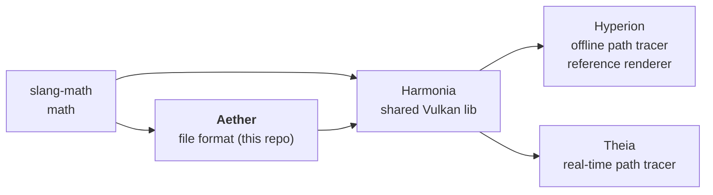

# AGENTS.md — Aether

Short orientation for coding agents that work in this repository. The complete documentation is
the [README](README.md); this file points the way and lists the facts that are easy to get wrong.
Roadmap, known limitations and release rules are in [PLAN.md](PLAN.md).

## What this repo is

**Aether** is the **file-format library** of a five-repository rendering pipeline. It defines
scenes, materials, cameras, presets (TOML) and the asset loaders, and it evaluates animation,
skinning and morph targets on the CPU. It holds **GPU-agnostic** data only: no renderer code, no
Vulkan, no GPU-optimized layouts.



- **Hyperion** is the offline path tracer, the reference renderer; **Theia** is the real-time
  accumulation path tracer that converges to Hyperion.
- Harmonia, Hyperion and Theia consume Aether through CMake **FetchContent** and link
  `aether::aether`.
- Aether never references the renderers. Renderer-aware tooling (such as
  `Harmonia/tools/compare_renders.py`) lives in Harmonia, not here.

## Where to read

| Topic | Document |
|-------|----------|
| File format: scenes, node graph, animation, skins, morph targets, materials, OBJ, opacity micromaps | [README.md](README.md#file-format-reference) |
| Build, tests, lint, coverage, consuming Aether | [README.md](README.md#building) |
| Authoring tools and the scene validator | [tools/README.md](tools/README.md) |
| Module layers and include rules | [ARCHITECTURE.md](ARCHITECTURE.md) |

## Assets

`assets/` is the canonical asset tree; the CMake variable `AETHER_ASSETS_DIR` points at it. Files
are TOML with keys spelled in full words. Material colours are linear Rec.709 unless the material
library declares otherwise (`colorspace = "lin_rec709_scene"` or `"lin_rec2020_scene"`); the
renderers convert to the working colour space.

The material model is **OpenPBR Surface** (Academy Software Foundation), tagged
`model = "openpbr"`. Parameters use the OpenPBR input names verbatim; OpenPBR's reference
implementation is MaterialX. A new parameter follows OpenPBR and MaterialX, never a
renderer-specific convention.

A scene section `[haze]` describes a medium between the camera and the scene: `density`, the
extinction per metre at height zero, and `height`, the height at which it has fallen to 1/e.
Aether validates the two keys together (one without the other, a negative density or a height
below or equal to zero is rejected) and hands them to the consumer; `Harmonia/shaders/haze.slang`
models the medium in both renderers.


### FetchContent asset trap (it bites every asset edit)

Hyperion and Theia do **not** read assets from this working tree. They read their own FetchContent
copy at `<Renderer>/build/_deps/aether-src/assets/`.

Editing `assets/` in this working tree has **no effect on a render** unless one of the following is
done:

- edit the copy under `<Renderer>/build/_deps/aether-src/assets/` directly, or
- configure the renderer with `-DFETCHCONTENT_SOURCE_DIR_AETHER=<path to the Aether checkout>`, so
  that `aether-src` points at the working tree, or
- copy the edited file into the `_deps` copy before rendering.

Symptom when this is forgotten: two "different" renders give **byte-identical metrics**.

### Render presets & sample counts (the low-spp reference trap)

Path-traced references are clean only at a high sample count. The image-based-lighting scenes
(`openpbr_*`, `shaderball_*`, `dragon_teapot`) reference meadow and relax presets of 64 to 256
samples per pixel; `preview.render.toml` is a fast 64-sample preset without image-based lighting.

Comparing a converged Theia image against a low-sample image-based-lighting reference measures
Monte-Carlo **noise**, not a real discrepancy. For such a comparison the Hyperion reference is
rendered at a high sample count (`hyperion --spp 256`) before any conclusion is drawn.

## Build & test

```powershell
cmake -S . -B build -G Ninja -DCMAKE_BUILD_TYPE=Release `
      -DCMAKE_C_COMPILER=clang-cl -DCMAKE_CXX_COMPILER=clang-cl `
      -DCMAKE_TOOLCHAIN_FILE="<vcpkg-root>/scripts/buildsystems/vcpkg.cmake"
cmake --build build
ctest --test-dir build --output-on-failure
```

The preset flow is equivalent: `cmake --preset win`, `cmake --build --preset win`,
`ctest --preset win`. `ctest -LE analysis` runs the unit tests only.

## Checks

| Check | Command |
|-------|---------|
| Tests | `ctest --test-dir build --output-on-failure` |
| clang-tidy | `python tools/check_tidy.py` |
| Architecture contract | `python tools/check_arch.py` (the rules in [ARCHITECTURE.md](ARCHITECTURE.md)) |
| Dead code | `python tools/check_dead.py --family ..` |
| Lint (the same checks as CI) | clang-format 22.1.3, cppcheck, `ruff check tools/`, bandit |

All CI jobs are blocking: lint, build and test on Windows and Linux, and coverage. Details and the
local commands: [README.md](README.md#testing) and [tools/README.md](tools/README.md#repository-checks).

## Scene validation loop: `aether-validate`

After an edit of a scene file, build and run the validator instead of checking the TOML by hand.
It is a thin wrapper over `aether::SceneParser::parse`; a green summary means "the library accepts
this scene".

```powershell
cmake --build build --target aether-validate
build\aether-validate.exe assets\<name>.scene.toml     # summary line
build\aether-validate.exe <scene.toml> --tree          # plus the node hierarchy
build\aether-validate.exe <scene.toml> --all           # plus every resolved instance
```

Exit codes: **0** accepted; **1** rejected (the `✘` line quotes the library's error verbatim and
names the offending node or track — fix exactly that); **2** usage problem (missing or unknown
argument, file not found). The validator reads the scene file only; it does not open OBJ files or
material libraries.

## Conventions

- Commit per repository, but do **not** push unless asked.
- A change is done when the tests pass and the build is warning-clean (warnings are errors; a
  warning is fixed at its cause, never silenced). A release additionally passes `verify-full`.
- Defects are fixed in the code that owns them as soon as they are known.
- OBJ winding must be outward-facing (counter-clockwise seen from outside); inward winding renders
  black (Hyperion derives emissive-triangle normals from winding).
- A sub-mesh keeps both its `o`/`g` name and its `usemtl` name; a scene's `materials` keys may use
  either. The Blender exporter emits a binding only for materials that exported faces use.
- Includes go only from `aether/format` to `aether/types`, along the declared edge, without cycles.
- Markdown follows the code: backticked file paths and relative links in `*.md` files must exist
  (the `check-docs-refs` skill script, configured by `.check-docs-refs.toml`).
