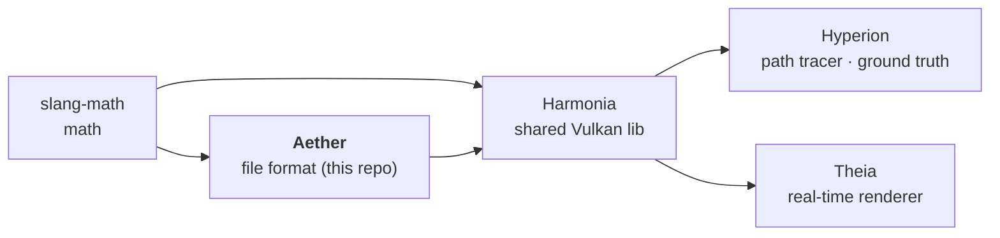

# AGENTS.md — Aether

Quick-start context for AI agents so basic facts don't have to be rediscovered.

**Outstanding work, governance (definition of done + guardrails) and release history: see
[`PLAN.md`](PLAN.md).**

## What this repo is

**Aether** is the abstract **file-format library** for the family's five-repo rendering pipeline.
It defines scenes, materials, cameras, tonemap/render presets and the asset loaders.
It holds **GPU-agnostic** scene/material/mesh data only — no renderer code, no Vulkan,
no GPU-optimized layouts.

Pipeline (dependency direction):



- **Hyperion** = offline path tracer, the **ground-truth** reference renderer.
- **Theia** = real-time accumulation path tracer, **converging to Hyperion**.
- Harmonia/Hyperion/Theia consume Aether via CMake **FetchContent**.

Aether must never reference the renderers. Renderer-aware tooling (e.g.
`compare_renders.py`) lives in Harmonia, not here.

## Assets

`assets/` is the canonical asset tree. `AETHER_ASSETS_DIR` (CMake) =
`${CMAKE_CURRENT_SOURCE_DIR}/assets`.

Material colors are linear Rec.709 unless the material lib says otherwise
(`colorspace = "lin_rec709_scene"`); renderers convert to the working color space.
Format is TOML (chosen as the best token/readability/comment compromise).

**Material model = OpenPBR Surface** (Academy Software Foundation). Material libraries are
tagged `model = "openpbr"` and use **OpenPBR parameter names** (`base_color`, `specular_ior`,
`transmission_weight`, `geometry_opacity`, `coat_*`, `subsurface_*`, `thin_film_*`, …).
OpenPBR's canonical/reference implementation is **MaterialX** (`mx_*` nodes); when adding or
naming parameters, follow OpenPBR/MaterialX, not a renderer-specific convention. The tag exists
so future material models can coexist.

### ⚠️ FetchContent asset gotcha (read this — it bites every asset edit)

Hyperion and Theia do **NOT** read assets from this working tree. They read from their
own FetchContent clone at `<Renderer>/build/_deps/aether-src/assets/`.

So **editing `assets/*.toml` in this working tree has NO effect on a render**
unless you do one of:
- edit the copy under `<Renderer>/build/_deps/aether-src/assets/` directly, or
- configure the renderer build with `-DFETCHCONTENT_SOURCE_DIR_AETHER=<path-to-aether>`
  (then `aether-src` points at this working tree), or
- copy the edited file into the `_deps` copy before rendering.

Symptom when you forget: two "different" renders produce **byte-identical** metrics.

### Render presets & sample counts (the low-spp reference trap)

Path-traced references are only clean at high spp. The IBL scenes (openpbr_*,
shaderball_*, dragon_teapot) reference the meadow/relax presets up to **256 spp**;
`preview.render.toml` is a fast **64 spp** direct-light-only preset (no IBL, used by the
cornell scenes).

Comparing Theia (noise-free) against a low-spp IBL reference inflates `mean_diff` with
Monte-Carlo **noise**, not a real discrepancy. For any IBL parity check, render the
Hyperion reference at high spp (`hyperion --spp 256`) before drawing conclusions.

## Build & test

```powershell
cmake -S . -B build -G Ninja -DCMAKE_BUILD_TYPE=Release `
      -DCMAKE_C_COMPILER=clang-cl -DCMAKE_CXX_COMPILER=clang-cl `
      -DCMAKE_TOOLCHAIN_FILE="<vcpkg-root>/scripts/buildsystems/vcpkg.cmake"
cmake --build build
cd build; ctest --output-on-failure
```

Equivalent preset flow (Ninja + Release + clang-cl + `$env:VCPKG_ROOT` toolchain):
`cmake --preset win` / `cmake --build --preset win` / `ctest --preset win`.

**Lint (CI):** `.github/workflows/build.yml` runs a **blocking** `lint (Q2-Q6)` job
on ubuntu-latest: clang-format (pinned 22.1.3 via pip - the local dev version; a
different version reformats differently and fails), cppcheck (explicit source-file
scan of `src/` + `include/`, gate = no `error:` severity), ruff over `tools/`
(contract: root `ruff.toml`, identical in all five family repos; findings stay at
zero - fix code, do not grow ignores), bandit (accepted tool-script patterns in the
`--skip` list), actionlint + yamllint on the workflows. Local pre-flight: run the
same commands from the repo root before pushing a lint-affecting change.

**Static analysis:** `python tools/check_tidy.py` — parallel clang-tidy over
`build/compile_commands.json`, classified per `.clang-tidy`'s WarningsAsErrors contract
(clang-diagnostic/clang-analyzer/bugprone fail the run; modernize/performance/portability
are report-only). Also registered as ctest `test_tidy` (label `analysis`; the fast test loop is `ctest -LE analysis`; skips when
clang-tidy, Python3 or the database is missing).
**Architecture gate:** `ARCHITECTURE.md` is the machine-checked architecture contract
(the document is the contract, the include graph is measured
against it). ctest `test_arch` runs the vendored `tools/check_arch.py` engine (label
`analysis`; registered where the check-arch engine is installed — local; not wired into CI). Contract:
`aether/types` is the leaf, `aether/format` consumes it, the root `aether`
vocabulary consumes both; includes may only go **down** that order and there must be **no
include cycles** (file-level SCC detection), declared edges only.

**

**Dead-code gate:** `python tools/check_dead.py` - orphan headers, never-compiled sources (absent from `compile_commands.json` AND unreferenced by any CMake file), and FetchContent declare/consume mismatches. Also registered as ctest `test_dead` (label `analysis`; local only - registration is gated on the per-user check-dead skill install, so CI runners skip it). Justified findings go into `tools/check_dead.exceptions` with a reason; real dead code is deleted in a fix commit.

Sanitizer lane (Clang/GCC configures only):** `-DAETHER_SANITIZER=address|undefined|thread`.
Host-side FP is deterministic (`/fp:strict` / `-ffp-contract=off -fno-fast-math`).

**Coverage lane (Clang/GCC configures only):** configure a separate build with
`-DAETHER_COVERAGE=ON` (e.g. `-B build/coverage`), then run `python tools/coverage.py` - it
builds the instrumented tree, runs the tests with `LLVM_PROFILE_FILE` set, merges the
profiles and prints the llvm-cov report for `src/` (gcc builds report via gcov; exit 77
when the LLVM tools are missing). Wired into CI as a blocking `coverage (Q1)` job
(ubuntu-26.04, clang + llvm tools) - the CPU suite runs in CI, so the report measures
real coverage.

### Scene validation loop: `aether-validate` (assembly gate)

Agents editing any `*.scene.toml` run the validator on **every** edit instead of
hand-auditing the TOML (build it first; the binary lands in `build/` next to the tests):

```powershell
cmake --build build --target aether-validate
build\aether-validate.exe assets\scenes\<name>.scene.toml   # summary line
build\aether-validate.exe <scene.toml> --tree               # + node hierarchy
build\aether-validate.exe <scene.toml> --all                # + every resolved instance
```

Exit codes: **0** = the library accepts the file (the counts come from the resolved
`SceneDesc` - trust them over the TOML text you just wrote); **1** = parse rejection - the
`✘` line quotes the library error verbatim (it names the offending node/track id), fix
exactly that; **2** = usage problem (missing/unknown argument, file not found). The tool
is a thin wrapper over `aether::SceneParser::parse` with no validation logic of its own,
so a green summary is exactly "the library accepts this scene" (node-graph and animation
validation included).

## Conventions

- Commit, but do **not** push unless asked.
- OBJ winding must be outward-facing (CCW-from-outside); inward winding renders black
  (Hyperion derives emissive-triangle normals from winding).
- Material model is **OpenPBR Surface** (tagged `model = "openpbr"`, MaterialX-defined); the tag
  exists so future models can coexist.
