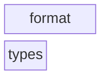
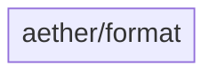
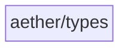

# Architecture

The checked-in architecture contract for Aether (the check-arch reflexion
gate). `aether/types` is the leaf, `aether/format` consumes it. Aether sits
below Harmonia in the family: any `harmonia/`/`theia/`/`hyperion/` include is
a hard violation (upward or sibling dependency).

<!-- check_arch: diagram BEGIN -->
### the layers



### layer format - the modules



### layer types - the modules


<!-- check_arch: diagram END -->

## The machine contract

```arch
scan: src
extensions: .hpp, .cpp
exclude: build, _deps, .git
unclassified: error
external: slang-math, toml++
forbidden: harmonia, theia, hyperion
quotes_relative: true
repo_fallback: false
cycles: true
namespace_root:
namespace_module:
namespace_require:
unresolved: info
within_layer: deny              # undeclared same-layer edges: violations
kind: library                   # public API surface: volume judged per file
smells: report                 # refactoring-catalog proxies: report-only review signals

layer types
layer format

module aether/types in types
module aether/format in format

allow aether/format -> aether/types
```
