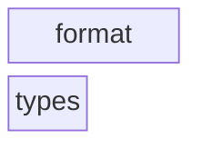
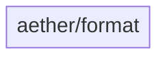
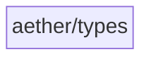

# Architecture

Aether has two layers. `aether/types` holds the plain data types and includes nothing else from
this repository; `aether/format` holds the parsers and the CPU evaluation and consumes the types.

This document is the architecture contract. `tools/check_arch.py` extracts the include graph of
the sources and compares it with the rules in the `arch` block below. Aether sits below Harmonia
in the repository family, and an include of a sibling repository (`harmonia/`, `theia/`,
`hyperion/`) is a hard violation.

The two diagrams between the `check_arch` markers are generated from the rules; they are not
edited by hand.

<!-- check_arch: diagram BEGIN -->
### the layers



### layer format - the modules



### layer types - the modules


<!-- check_arch: diagram END -->

## The machine contract

```arch
scan: src
extensions: .hpp, .cpp
exclude: build, _deps, .git
unclassified: error
external: slang-math, toml++
forbidden: harmonia, theia, hyperion
quotes_relative: true
repo_fallback: false
cycles: true
namespace_root:
namespace_module:
namespace_require:
unresolved: info
within_layer: deny              # undeclared same-layer edges: violations
kind: library                   # public API surface: volume judged per file
header_size: error               # the standing bloat rule (hard gate)
smells: report                 # report-only

layer types
layer format

module aether/types in types
module aether/format in format

allow aether/format -> aether/types
```

## How to read the contract

The `arch` block is the only source of the rules; the rest of this document explains it.

| Rule in the block | Meaning |
|-------------------|---------|
| `scan: src`, `extensions: .hpp, .cpp`, `exclude: build, _deps, .git` | Every `.hpp` and `.cpp` file under `src/` is scanned, except those three directories |
| `module aether/types in types`, `module aether/format in format` | A module is a directory under `src/`: `src/aether/types` and `src/aether/format` |
| `layer types`, `layer format` | The stack, bottom first. A dependency may only point from a higher layer to a lower one: `format` → `types` |
| `allow aether/format -> aether/types` | The only declared dependency. Any other include from one module into the other is a violation |
| `within_layer: deny` | An undeclared include between two modules of the same layer is a violation as well |
| `unclassified: error` | A scanned file that belongs to neither module fails the check |
| `forbidden: harmonia, theia, hyperion` | An include that names a sibling repository is a hard violation |
| `external: slang-math, toml++` | Includes of the two dependencies are allowed and listed in the report |
| `quotes_relative: true`, `repo_fallback: false` | A quoted include resolves relative to the file that includes it, and nowhere else |
| `cycles: true` | No cycle in the include graph, down to single files |
| `header_size: error` | A scanned file with the line limit (1000 by default) or more lines fails the check |
| `kind: library` | Aether is a library: a module without a consumer inside the repository is public API, not dead code |
| `smells: report` | The refactoring smells are listed with `--report` or `--json` and never fail the check |
| `unresolved: info` | A quoted include that resolves to nothing is reported as information |
| `namespace_root`, `namespace_module`, `namespace_require` (empty) | The namespace check is switched off |

Includes inside one module are free; only the edges between modules are declared.

## The modules

| Module | Files | Role |
|--------|-------|------|
| `aether/types` | `SceneDesc.hpp`, `MaterialDesc.hpp`, `MeshData.hpp`, `OpacityMicromap.hpp`, `TextureColorSpace.hpp`, `Math.hpp` | Plain data structures. The only external include is slang-math (`Math.hpp`) |
| `aether/format` | `SceneParser`, `SceneAnimator`, `NodeGraph`, `Skinning`, `Morphing`, `MaterialLibrary` with `MaterialKwTables.hpp`, `ObjImporter`, `OmmImporter`, `toml_readers.hpp` | Parsers for every file type, the node-graph resolution and the CPU evaluation of animation, skinning and morph targets. External includes: toml++ and slang-math |

`tools/validate.cpp` and the tests sit outside the scanned root; they use the public headers of
`aether/format` and `aether/types`.

## Running the check

```bash
python tools/check_arch.py            # the check
python tools/check_arch.py --report   # plus the layer stack and the measured module graph
```

The check is registered as the CTest test `test_arch` where the check-arch skill is installed.
It is not part of CI.

## Changing the architecture

1. Edit the `arch` block: the layers, the modules or the `allow` edges.
2. Run `python tools/check_arch.py --diagram` to regenerate the two diagrams from the rules.
3. Run the check; it also fails when the diagrams no longer match the rules.

To draft a contract for a new structure, `python tools/check_arch.py --derive` writes an
`ARCHITECTURE.md` from the include graph it measures.
