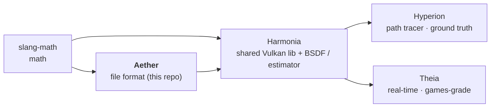

# PLAN — Aether

**Living source of truth for outstanding work.** Shipped items are removed from the work
lists; the shipped record is the *Baseline* below and `git log`. Only outstanding work is
tracked here.

**How to read this plan** — *human / PM:* *How to continue* is the prioritized next-up list.
*AI agent picking up work:* read `AGENTS.md` (orientation, gotchas — especially the
FetchContent asset trap) → *How to continue* (your task) → *Governance* (definition of done +
guardrails) **before editing**.

## Context

Aether is the GPU-agnostic file-format library of a five-repo rendering pipeline:



The family's goal is OpenPBR 1.1.1 as the single material standard, with Theia converging to
Hyperion's unbiased ground truth. Aether owns scene/material/mesh **data** and authoring
tools — never renderer code, never Vulkan. Sibling plans: `Harmonia/PLAN.md`,
`Hyperion/PLAN.md`, `Theia/PLAN.md`, `slang-math/PLAN.md` in the sibling clones.

## At a glance

- **Release:** v0.7.4 (tag-synced with GitHub); consumed via FetchContent pins by
  Harmonia → Hyperion/Theia.
- **Last shipped (v0.7.4):** OpenPBR 1.1.1 spec-default conformance (coat_ior 1.6,
  thin_film_ior 1.4, thin_film_thickness 500 nm) + `specular_weight` > 1 parser acceptance
  (see Baseline).
- **Next:** NH1 (node graph) — it unblocks the animation track (ANI) across the family.

## How to continue

### Metadata track (META) — agent-legible format

**Goal:** when an agent reads an Aether TOML it *understands* the scene without further
reading — and, crucially, can **skip opening linked files** because their essentials are
summarised inline (what the thing is, its bounds incl. orientation, and enough content
summary to reason about it). Unblocked and independent of AR1/NH1.

| ID | Task | Deps | Status |
|----|------|------|--------|
| META1 | **`[meta]` block in the scene/material TOML** — optional, backward compatible (existing scenes parse unchanged; unknown tables already ignored). `[meta]`: `schema`/`version`, `model = "openpbr"`, `title`, `description` (agent-readable prose), `units`, `generator`. **`[meta.link."<path>"]` per linked file** — `kind` (`material-library` \| `mesh` \| `env` \| `micromap` \| `scene`), `description` (e.g. *"Suzanne the monkey — glossy ceramic, this is the snow-scene hero"*), plus the skip-the-file summary: `bounds` = AABB **with frame/orientation** (`{ min, max, frame = "object", orientation = [x,y,z,w] }` — object-space AABB + the instance TRS already in the scene makes the world AABB derivable), content counts (`triangles`, `groups`, `materials = [...]`), and per-material one-liners where useful. Parser stores it (`SceneDesc.meta` / `LinkMeta` in `src/aether/types/`); generators populate it (`blender_to_aether`, `mtlx_to_aether`, `omm_bake`); nothing consumes it yet — the consumer is the agent. | — | **next** |
| META2 | **Generator population + docs** — emit `[meta]` from the tooling (descriptions templated, overridable via a `--meta-description` flag or a `.meta.toml` sidecar), document the block in `tools/README.md` + `AGENTS.md`; tests assert parse round-trip and that summaries match the linked files (bounds/counts verified against the real assets). | META1 | backlog |

Schema sketch (scene TOML):

```toml
[meta]
schema = "aether-scene"
version = 1
model = "openpbr"
title = "Suzanne in the snow"
description = "Snow scene: Suzanne (glossy ceramic) on a snowy ground; sun IBL, falling snow via opacity masks."
units = { length = "m", luminance = "nits" }
generator = "blender_to_aether"

[meta.link."materials/snow.toml"]
kind = "material-library"
description = "Physically based OpenPBR materials for the snow scene."
materials = ["snow", "ceramic_white"]

[meta.link."meshes/suzanne.obj"]
kind = "mesh"
description = "Suzanne the monkey - glossy ceramic, the snow-scene hero."
bounds = { min = [-0.50, -0.31, -0.42], max = [0.50, 0.48, 0.31], frame = "object", orientation = [0, 0, 0, 1] }
triangles = 2904
groups = ["default"]
```

### Node hierarchy track (NH) — Aether slice

Aether today carries flat instances with per-instance TRS (`parseTRS`). A parent/child node
graph lets a child inherit and compound its parent's transform, and enables instanced
subtrees. The shared consumption (transform compounding) lives in Harmonia (NH2,
Harmonia/PLAN.md).

| ID | Task | Deps | Status |
|----|------|------|--------|
| NH1 | **Node graph in Aether** — extend the scene TOML + `SceneParser`: parent/child nodes with compounded TRS; instances reference a node path. Today `InstanceDesc` (`src/aether/types/SceneDesc.hpp:87`) is flat with no parent field. | — | backlog |
| NH4 | **DCC round-trip** — `blender_to_aether` / `mtlx_to_aether` emit the hierarchy (Blender collections/parents → Aether nodes). Standing constraint: Blender authors no OpenPBR, and the MaterialX path rejects non-OpenPBR sources (`tools/README.md`) — hierarchy export does not change that. | NH1 | backlog |

### Animation track (ANI) — Aether slice

| ID | Task | Deps | Status |
|----|------|------|--------|
| ANI1 | **Keyframed transform channels (schema)** — Aether carries the timeline: per-node translate/rotate/scale vs time (interpolated) in the scene format. The renderer-side sampling at shutter time lives in Harmonia/Hyperion/Theia (their PLAN.md files). | NH1 | backlog |

### Downstream-library migration

| ID | Task | Deps | Status |
|----|------|------|--------|
| SM6-Aether | **slang-math v0.3.0 migration slice** — replace the 12 hand-rolled `std::clamp(x,0,1)` lambdas in `src/aether/format/MaterialLibrary.cpp` with `sm::saturate`; the FetchContent pin bump to slang-math v0.3.1 is DONE (2026-10-15, verified 44/44) in this repo's release commit. Track origin: slang-math/PLAN.md SM6. | slang-math v0.3.0 tag | backlog |

## Governance

**Definition of done (per change):** `ctest` green **+** warning-clean build (strict
warnings-as-errors: clang-cl `/W4 /WX`, Clang/GNU `-Wall -Wextra -Werror -Wpedantic`; a
compiler warning is a build failure — fix the cause, never silence it). **Per release:** the
above plus `verify-full` (verify + format-check + clang-tidy + cppcheck).

**Guardrails:**

- Aether must never reference the renderers (AGENTS.md) — GPU-agnostic CPU data only.
- **OpenPBR Surface 1.1.1** is the material standard; parameter naming follows OpenPBR /
  MaterialX, never a renderer-specific convention.
- Fix bugs at once — root-caused and patched in the same session. Deferral is not an
  acceptable resolution for a known defect.
- Solve directly, never defer: divergences are root-caused and fixed in code.
- Tags are always pushed to GitHub — after any local tag, verify `git ls-remote --tags
  origin` == `git tag -l`. Release order follows the dependency direction (slang-math →
  **Aether** → Harmonia → Theia/Hyperion); downstream FetchContent pins bump to the fresh tag
  in their own release commits.
- Commit per-repo; push only on explicit OK.
- Living document — done work is removed from this file; the record is the Baseline and
  `git log`.

## Baseline

- **v0.7.6** (current): **code-health wave: dead surface removed + architecture gate.**
  The `Aether.hpp` umbrella header had zero consumers in all five repos (no include, no
  CMake reference) — deleted per the only-latest-and-greatest rule. `tools/check_layers.py`
  (ctest `test_layers`, label `analysis`): the module DAG `aether/types` ← `aether/format`
  ← root, file-level cycle detection, and any `harmonia/`/`theia/`/`hyperion/` include
  fails (Aether sits below Harmonia; the sibling renderers are out of reach). 44/44 ctest
  on Windows; Linux suite green.
- **v0.7.5** (ships with the family 2026-10-09 wave): **dual-OS CI + badge; test
  registration for the CI ctest lane.** `.github/workflows/build.yml` on `windows-latest` +
  `ubuntu-26.04` with the Git LFS asset checkout (Aether owns the family's LFS content); the
  CPU suite runs in CI (43/43 on both OSes); `tests/CMakeLists.txt` registers the CI ctest
  lane. **No library code changes since v0.7.4** — the parser and format are identical, so
  downstream pins may remain at v0.7.4 until the next wave.
- **v0.7.4** (ships alongside the family v0.7.8): **OpenPBR 1.1.1 spec-default
  conformance** — `coat_ior` default 1.6 (was 1.5), `thin_film_ior` default 1.4 (was 1.5),
  `thin_film_thickness` default 500 nm (spec 0.5 µm; was 0) — inert for all shipped assets
  (every coated/thin-film material sets the parameters explicitly) — and the parser now
  accepts `specular_weight` > 1 (spec range [0,∞); the mandated ξ_s·F_s ≤ 1 clamp lives in
  the shader, Harmonia v0.7.8). **Tooling**: `CMakePresets.json`
  (`win` = Ninja + Release + clang-cl + `$env{VCPKG_ROOT}` toolchain),
  `tools/check_tidy.py` (parallel classified clang-tidy lane) + ctest `test_tidy` (label
  `analysis`), `AETHER_SANITIZER` option (Clang/GCC), deterministic host FP
  (`/fp:strict` / `-ffp-contract=off -fno-fast-math`). 43 ctest green at ship time (incl.
  the tidy lane).
- **v0.7.3** (shipped alongside the family v0.7.7): the **opacity-micromap asset
  format** — `aether::OpacityMicromapData`/`OpacityMicromapGroup`
  (`src/aether/types/OpacityMicromap.hpp`), the `.omm` text-sidecar + `.micromap.toml`
  descriptor importer (`OmmImporter`), `MaterialDesc::map_opacity` (data-space texture),
  `MeshDesc::opacityMicromaps` (OBJ-group → baked-asset reference), and the standalone Python
  baker `tools/omm_bake.py` (PNG decode/encode, OBJ parse, the Vulkan/glTF
  space-filling-curve microtriangle index, conservative range-sampled classification — a
  microtriangle is only ever declared uniform where the renderer's own bilinear/wrap-repeat
  sampling could not disagree). New showcase scene `shaderball_checker.scene.toml` (+materials
  + baked `.omm`/`.micromap.toml` + the checker opacity PNG). 42 ctest green at ship time.
- **BV1** (earlier): `MeshDesc::bounds` — optional authorable object-space AABB
  (`bounds = { min=[...], max=[...] }`) + `tools/obj_bounds.py` (stdlib-only OBJ→AABB,
  `--write` in-place, optional Ritter sphere). Consumers shipped downstream (Harmonia BV2,
  Theia BV3).
- **v0.7.2**: `applyKw` table-driven dispatch (family code-health pass).
- Earlier history in `git log`.
