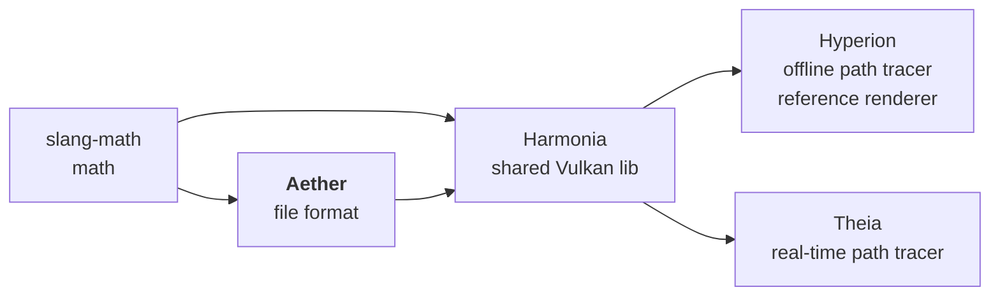
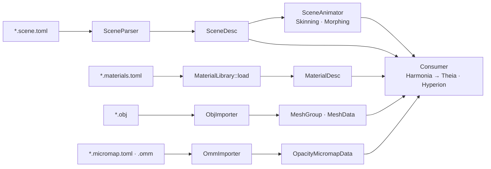

# Aether

[](https://github.com/McNopper/Aether/actions/workflows/build.yml)

Aether is the scene and material file format shared by the
[Hyperion](https://github.com/McNopper/Hyperion) and [Theia](https://github.com/McNopper/Theia)
renderers. It is a small C++23 library that reads TOML scene files, TOML material libraries,
Wavefront OBJ geometry and opacity-micromap assets into plain CPU data structures, and that
evaluates animation, skinning and morph targets on the CPU.

> *[Aether](https://en.wikipedia.org/wiki/Aether_(mythology))* — primordial deity of the bright
> upper air and pure light the gods breathe; the medium through which light travels. The library
> is that medium: it carries a scene's description and belongs to no renderer or GPU.

## Contents

- [The repository family](#the-repository-family)
- [What Aether is](#what-aether-is)
- [Design choices](#design-choices)
- [Repository layout](#repository-layout)
- [Building](#building)
- [Testing](#testing)
- [Using Aether from another project](#using-aether-from-another-project)
- [Checking a scene file](#checking-a-scene-file)
- [File format reference](#file-format-reference)
- [Example scenes](#example-scenes)
- [Conventions](#conventions)
- [Dependencies](#dependencies)
- [References](#references)

## The repository family

Aether is one of five repositories that together form a rendering pipeline:

| Repository | Role |
|------------|------|
| [slang-math](https://github.com/McNopper/slang-math) | Math library (vectors, quaternions, matrices) |
| **Aether** (this repository) | File-format library: scenes, materials, cameras, presets (TOML) and asset loaders |
| [Harmonia](https://github.com/McNopper/Harmonia) | Shared Vulkan library: application host, scene loading, shaders, estimators, tools |
| [Theia](https://github.com/McNopper/Theia) | Real-time accumulation path tracer |
| [Hyperion](https://github.com/McNopper/Hyperion) | Offline path tracer, the reference renderer |



Dependencies point one way: slang-math → Aether → Harmonia → Theia and Hyperion. Aether depends
on slang-math only and never references a renderer. Code that needs to know about a renderer, such
as the render-comparison tools, lives in Harmonia.

| Document | Content |
|----------|---------|
| `README.md` (this file) | Overview, build, tests, the file-format reference, conventions |
| [tools/README.md](tools/README.md) | The authoring tools: Blender exporter, MaterialX converter, OBJ utilities, opacity-micromap baker, repository checks |
| [ARCHITECTURE.md](ARCHITECTURE.md) | The module layers and the include rules the architecture check enforces |
| [PLAN.md](PLAN.md) | Outstanding work, known limitations, release rules, release history |
| [RELEASE_NOTES.md](RELEASE_NOTES.md) | Notes of each release |
| [AGENTS.md](AGENTS.md) | Short orientation for coding assistants working in this repository |

## What Aether is

Aether turns text files into plain CPU structs. It has no Vulkan, no GPU and no renderer
dependency. Consumers (Harmonia and through it the renderers) load the referenced files, convert
colours, upload geometry and build acceleration structures.

| Input | Parser | Result |
|-------|--------|--------|
| `*.scene.toml` | `aether::SceneParser::parse` | `aether::SceneDesc`: settings, camera, meshes, instances, node graph, animation tracks, skins, morph targets, metadata |
| `*.materials.toml` | `aether::MaterialLibrary::load` | One `aether::MaterialDesc` per material: OpenPBR Surface parameters and texture references |
| Wavefront OBJ | `aether::ObjImporter::parse` | A list of `aether::MeshGroup`, each holding an `aether::MeshData` with deduplicated vertices and triangle indices |
| `*.micromap.toml` with an `.omm` sidecar | `aether::OmmImporter::parse` | `aether::OpacityMicromapData`: packed per-triangle opacity-micromap records |

`aether::SceneAnimator` samples the animation tracks and re-resolves the node graph.
`aether::deformSkinLbs`, `aether::deformSkinDqs` and `aether::deformMorphs` are the CPU reference
implementations of the two skinning methods and of morph targets; the GPU paths of the renderers
must match them.



## Design choices

- Geometry stays in OBJ, the one part that needs a compact vertex and index container. Everything
  else (scene, camera, render settings, tonemapping, materials, presets) is TOML, so files are
  small, single-purpose and easy to edit by hand. Geometry is returned in object space; world
  placement lives in the scene file.
- TOML was chosen as the best compromise between readability, comments and compactness. Compared
  with equivalent pretty-printed JSON the files need up to a third fewer tokens, which also keeps
  them inexpensive for language models to read. Minified JSON would be denser but is no longer
  readable or editable by hand.
- The material model is OpenPBR Surface, and material parameters use the OpenPBR input names
  verbatim, so nothing is lost in translation. The reference implementation of OpenPBR is
  MaterialX; when a parameter is added or named, OpenPBR and MaterialX are followed rather than a
  renderer-specific convention.
- Composition is lightweight: a scene references preset files for render settings, the camera and
  tonemapping and overrides single keys inline.
- glTF is a delivery format with binary buffers built for engines to load; its core material is
  metallic-roughness and OpenPBR is only partly reachable through extensions. OpenUSD is a
  composition and interchange system that is far more than a small renderer needs. Aether takes one
  idea from each: text that can be diffed and edited (like a USD layer) and a separate geometry
  container (like glTF's buffers, but OBJ) — and stays small.

For editing the files, the VS Code extension *Even Better TOML* provides syntax highlighting and
formatting for the TOML files.

## Repository layout

| Path | Content |
|------|---------|
| `src/aether/types/` | Plain data types: `SceneDesc.hpp`, `MaterialDesc.hpp`, `MeshData.hpp`, `OpacityMicromap.hpp`, `TextureColorSpace.hpp`, `Math.hpp` |
| `src/aether/format/` | Parsers and CPU evaluation: `SceneParser`, `MaterialLibrary`, `ObjImporter`, `OmmImporter`, `NodeGraph`, `SceneAnimator`, `Skinning`, `Morphing` |
| `tests/` | GoogleTest unit tests (CPU only) |
| `tools/` | Authoring tools, the scene validator and the repository checks, described in [tools/README.md](tools/README.md) |
| `assets/` | The canonical asset tree: example scenes, material libraries, OBJ meshes, textures, environment maps and presets |
| `cmake/` | Compiler settings (`cmake/Platform.cmake`) and the cppcheck integration (`cmake/cppcheck.cmake`) |
| `.github/workflows/build.yml` | Continuous integration: lint, build and test on Windows and Linux, coverage |

## Building

### Requirements

- CMake 3.28 or newer, Ninja, a C++23 compiler and vcpkg in manifest mode.
- vcpkg provides toml++. slang-math is pulled with CMake `FetchContent` (the tag is pinned in
  `CMakeLists.txt`). GoogleTest is fetched the same way, for the tests only.
- Windows is built with clang-cl, Linux with g++ (both in continuous integration). macOS is not
  supported; the configure step stops with an error.
- Git LFS for a full checkout: the OBJ meshes, the EXR environment maps and the `.blend` file are
  stored with it, and the unit tests read them.
- Python 3.11 or newer for the tools under `tools/`.

### Configure and build

Windows (PowerShell):

```powershell
cmake -S . -B build -G Ninja -DCMAKE_BUILD_TYPE=Release `
      -DCMAKE_C_COMPILER=clang-cl -DCMAKE_CXX_COMPILER=clang-cl `
      -DCMAKE_TOOLCHAIN_FILE="<vcpkg-root>/scripts/buildsystems/vcpkg.cmake"
cmake --build build
```

Linux (bash):

```bash
cmake -S . -B build -G Ninja -DCMAKE_BUILD_TYPE=Release \
      -DCMAKE_C_COMPILER=gcc -DCMAKE_CXX_COMPILER=g++ \
      -DCMAKE_TOOLCHAIN_FILE="<vcpkg-root>/scripts/buildsystems/vcpkg.cmake"
cmake --build build
```

The repository ships one CMake preset, `win` (Ninja, Release, clang-cl, toolchain from the
`VCPKG_ROOT` environment variable):

```powershell
cmake --preset win
cmake --build --preset win
ctest --preset win
```

The library target is `aether`, with the alias `aether::aether`. Aether's own targets get the
warnings-as-errors settings (`/W4 /WX` for MSVC-style compilers, `-Wall -Wextra -Werror
-Wpedantic` for Clang and GCC) and the deterministic floating-point flags (`/fp:strict` or
`-ffp-contract=off -fno-fast-math`) through the interface target `aether_project_options`.

### Options and targets

| CMake option | Default | Effect |
|--------------|---------|--------|
| `AETHER_SANITIZER` | empty | `address`, `undefined` or `thread`: build with that sanitizer. Needs Clang or GCC with a non-MSVC front end (Ninja with clang, or WSL) |
| `AETHER_COVERAGE` | `OFF` | `ON`: instrument for coverage (see [Coverage](#coverage)) |
| `BUILD_TESTING` | `ON` | Build the tests |

The executable `aether-validate` and the tests are built only when Aether is the top-level project.
The custom targets exist only at the top level as well:

| Target | Runs |
|--------|------|
| `verify` | Build, then the tests |
| `verify-full` | `verify`, plus `format-check`, `cppcheck` and `tidy` where they exist |
| `format`, `format-check` | clang-format over the sources (rewriting, or checking with `--Werror`) |
| `tidy` | clang-tidy over every translation unit; fixes go to `build/reports/clang-tidy/fixes.yaml` |
| `cppcheck`, `cppcheck-strict`, `cppcheck-xml` | cppcheck with the default, the exhaustive and the XML-report profile |

`format` and `format-check` exist when clang-format is installed. `tidy` and the cppcheck targets
exist when the generator is Ninja or Makefiles and the compiler is Clang or GCC.

## Testing

### Unit tests

The unit tests need no GPU and no Blender:

```bash
ctest --test-dir build --output-on-failure     # everything
ctest --test-dir build -LE analysis           # unit tests only
```

`aether_tests` holds 167 GoogleTest cases: scene parser, material library, OBJ importer, opacity
micromap, animation, skinning, morphing and a Blender round trip. The round-trip test parses the
Blender-exported fixture scenes in `assets/` with the real parsers and checks the exporter's
deformation rows against the importer's vertex order.

Three tests carry the label `analysis`: `test_tidy` is registered whenever Python is found, and
`test_arch` and `test_dead` are registered only where the check-arch and check-dead skills are
installed in the user's OpenCode configuration. Each skips itself (exit code 77) when its tool is
missing.

The Python tools have their own test scripts; they are not registered with CTest:

```bash
python tools/mtlx_to_aether/tests/run_tests.py
python tools/test_obj_transform.py
python tools/test_obj_bounds.py
python tools/test_omm_bake.py
```

### Static analysis

| Check | Command | Catches |
|-------|---------|---------|
| clang-tidy | `python tools/check_tidy.py` | Findings of the categories `clang-diagnostic-*`, `clang-analyzer-*` and `bugprone-*`; the other categories are summarized only |
| Architecture | `python tools/check_arch.py` | A violation of the contract in [ARCHITECTURE.md](ARCHITECTURE.md) |
| Dead code | `python tools/check_dead.py` | Orphan headers, sources that are never compiled, FetchContent declarations that are never consumed |

Each exits with 0 when clean and 1 on findings. Options, skip codes and outputs are described in
[tools/README.md](tools/README.md#repository-checks). A justified dead-code finding is listed in
`tools/check_dead.exceptions` with its reason; real dead code is deleted instead.

### Coverage

Coverage needs Clang: the report is produced with `llvm-profdata` and `llvm-cov`.

```bash
cmake -S . -B build/coverage -G Ninja -DCMAKE_BUILD_TYPE=Release \
      -DCMAKE_C_COMPILER=clang -DCMAKE_CXX_COMPILER=clang++ \
      -DCMAKE_TOOLCHAIN_FILE="<vcpkg-root>/scripts/buildsystems/vcpkg.cmake" \
      -DAETHER_COVERAGE=ON
python tools/coverage.py
```

`tools/coverage.py` builds the instrumented tree, runs the tests with `LLVM_PROFILE_FILE` set,
merges the profiles and prints the line coverage of `src/` (options:
[tools/README.md](tools/README.md#coveragepy)).

### Lint

Continuous integration runs three jobs on every push and pull request:

| Job | Runner | Content |
|-----|--------|---------|
| lint | ubuntu-latest | clang-format (pinned to 22.1.3), cppcheck, ruff, bandit, actionlint and yamllint |
| build | windows-latest and ubuntu-26.04 | Configure, build and run the unit tests with clang-cl and g++ |
| coverage | ubuntu-26.04 | Build instrumented with clang and run `tools/coverage.py` |

The lint job fails when clang-format would change a file, when cppcheck reports an `error`
severity, when ruff or bandit report a finding over `tools/`, or when actionlint or yamllint report
a problem in the workflow files. The ruff rule set is in `ruff.toml` and is the same in all five
repositories; a finding is fixed in the code, not added to the ignore list. bandit runs with the
skips `B101,B314,B404,B405,B603,B607`.

The same checks can be run before pushing:

```bash
clang-format --dry-run --Werror --style=file <source files>   # src/, tests/, *.cpp and *.hpp
ruff check tools/
bandit -r tools/ -q --skip B101,B314,B404,B405,B603,B607
```

## Using Aether from another project

Harmonia pulls Aether with CMake `FetchContent` and links `aether::aether`:

```cmake
include(FetchContent)
FetchContent_Declare(aether
    GIT_REPOSITORY https://github.com/McNopper/Aether.git
    GIT_TAG <release tag>)
FetchContent_MakeAvailable(aether)
target_link_libraries(my_target PRIVATE aether::aether)
```

The CMake cache variable `AETHER_ASSETS_DIR` points at the `assets/` directory (`<aether source
dir>/assets` by default); consumers use it to resolve the asset paths that scenes record.

The renderers do not read assets from a local Aether working tree. They read the FetchContent
copy at `<renderer>/build/_deps/aether-src/assets/`, so an edit of a file in `assets/` has no effect
on a render until one of the following is done:

- the same edit is made in the `_deps` copy, or
- the renderer is configured with `-DFETCHCONTENT_SOURCE_DIR_AETHER=<path to the Aether checkout>`,
  which makes `aether-src` point at that checkout, or
- the edited file is copied into the `_deps` copy.

The symptom of a forgotten step is two "different" renders with byte-identical metrics.

Aether has no renderer and no demo binary. To render a scene, run it with Theia or Hyperion; see
those repositories for the command line.

## Checking a scene file

`aether-validate` is a small command-line tool over `aether::SceneParser::parse`, built at the top
level only. It checks a scene file the way the library reads it and prints what the library makes of
it:

```powershell
cmake --build build --target aether-validate
build\aether-validate.exe assets\cornell_classic.scene.toml          # one summary line
build\aether-validate.exe assets\skinned.scene.toml --tree           # plus the node hierarchy
build\aether-validate.exe assets\skinned.scene.toml --all            # plus every resolved instance
```

| Exit code | Meaning |
|-----------|---------|
| 0 | The library accepts the file |
| 1 | The library rejected it; the `✘` line quotes the library's error message |
| 2 | Usage problem: missing or unknown argument, or the file does not exist |

The summary line counts instances, meshes, nodes, material libraries and lights. It does not load the
OBJ or material files, so the per-vertex row counts of skins and morph targets are not checked here;
the scene loader checks them at load time.

## File format reference

- [Files and notation](#files-and-notation) and [how relative paths resolve](#how-relative-paths-resolve)
- Scenes: [settings sections](#settings-sections), [preset references](#preset-references),
  [transforms](#transforms), [meshes](#meshes), [instances and material bindings](#instances-and-material-bindings),
  [node graph](#node-graph), [animation](#animation), [camera bound to a node](#camera-bound-to-a-node),
  [skinning](#skinning), [morph targets](#morph-targets), [scene metadata](#scene-metadata)
- [Material libraries](#material-libraries)
- [OBJ geometry](#obj-geometry)
- [Opacity micromaps](#opacity-micromaps)
- [What is checked and what is ignored](#what-is-checked-and-what-is-ignored)

The evaluation API is described with animation: [Evaluation API](#evaluation-api).

### Files and notation

- File types: scenes are `*.scene.toml`, material libraries `*.materials.toml`, camera presets
  `*.camera.toml`, render presets `*.render.toml`, tonemap presets `*.tonemap.toml`, opacity
  micromaps a `*.micromap.toml` descriptor with an `.omm` text sidecar, geometry `.obj`.
- Keys are spelled as full words (`samples_per_pixel`, `environment_map`, `vertical_field_of_view`).
- Vectors are `[x, y, z]`, colours `[r, g, b]`, quaternions `[x, y, z, w]`. Angles are in degrees.
- Scenes are right-handed, Y-up, with −Z as the forward direction, and in metres.
- Colours are linear. A material library declares its primaries with `colorspace`; the consumer
  converts to the working colour space.

An *instance* is one placed mesh with a transform and a material. A *sub-mesh* is one part of an
OBJ file between two `o`, `g` or `usemtl` statements; the C++ API and keys such as `materials`
call it a *group*.

A minimal scene:

```toml
material_libraries = ["floor.materials.toml"]

[render]
reference = "presets/preview.render.toml"

[camera]
translate = [0.0, 1.0, -6.0]
rotate_x = 5.0
vertical_field_of_view = 40.0
ev100 = 8.0

[tonemap]
reference = "presets/aces.tonemap.toml"

[[mesh]]
name = "floor"
type = "box"
half_extents = [5.0, 0.1, 5.0]

[[mesh]]
name = "ball"
path = "ball.obj"

[[instance]]
mesh = "floor"
material = "NeutralFloor"
translate = [0.0, -0.1, 0.0]

[[instance]]
mesh = "ball"
material = "Red"
translate = [0.0, 1.0, 0.0]
```

A scene file is parsed in this order: material libraries, the four settings sections, metadata,
meshes, flat instances, the node graph (which appends one instance per meshed node), the camera's
node binding, skins, morph targets, animation tracks, analytic lights.

### How relative paths resolve

| Path | Resolved by | Relative to |
|------|-------------|--------------|
| `reference` in `[render]`, `[camera]`, `[tonemap]`, `[post_tonemap]`, `[haze]` | Aether, at parse time | The scene file's directory |
| `file` in `[data]` of a micromap descriptor | Aether, at parse time | The descriptor's directory |
| `material_libraries`, mesh `path`, `environment_map`, `opacity_micromaps`, texture paths | The consumer | Aether records them exactly as written |

Harmonia's scene loader uses an absolute path as it is, looks for a relative path in the scene
file's directory first and then in the assets directory.

### Settings sections

Each of the five sections is optional. Only the keys that are present are applied.

`[render]`:

| Key | Type | Meaning |
|-----|------|---------|
| `samples_per_pixel` | integer | Samples per pixel |
| `max_depth` | integer | Maximum ray depth |
| `environment_map` | string | Equirectangular EXR used as image-based lighting |
| `environment_unit_nits` | number | cd/m² per unit of the environment map's values |
| `working_color_space` | string | Scene-referred working colour space: `lin_rec2020_scene`, `lin_rec709_scene`, or `lin_ap1_scene` (ACEScg). Absent: the consumer's default (Rec.2020). All assets are converted into it |

`[camera]`:

| Key | Type | Meaning |
|-----|------|---------|
| `translate`, `rotate`, `rotate_x`, `rotate_y`, `rotate_z`, `scale` | see [Transforms](#transforms) | Placement. Forward is `rotation * (0, 0, -1)`, up is `rotation * (0, 1, 0)`. `scale` is read for symmetry with instances and has no meaning for a camera |
| `vertical_field_of_view` | number | Vertical field of view in degrees |
| `ev100` | number | Exposure value of the camera |
| `exposure_compensation_ev` | number | Additional scene-wide exposure in stops; the consumer multiplies exposure by `2^value`. Absent: 0 |
| `lens_radius` | number | Thin-lens aperture radius in metres. 0 or absent keeps the pinhole camera |
| `focus_distance` | number | Thin-lens focus distance in metres; must be finite and positive when authored |
| `node` | string | Binds the camera to a node; see [Camera bound to a node](#camera-bound-to-a-node) |

`[tonemap]` has one key, `tonemapper`, a keyword that names the tone-mapping curve (for example
`"aces"` or `"agx"`, the two presets included in `assets/presets/`). `[post_tonemap]` has one key,
`renderer`, a keyword that selects an optional post-tonemap renderer (for example
`"green_screen"`). Aether records both tokens as written and does not validate them; the consumer
maps them to its modes.

`[haze]` describes a distance haze between the camera and the scene. It is an opt-in medium
with two keys:

| Key | Type | Meaning |
|-----|------|---------|
| `density` | number | Extinction per metre at height zero. The extinction falls exponentially with the height |
| `height` | number | Height in metres above height zero at which the extinction has fallen to 1/e |

```toml
[haze]
density = 0.0003     # along a horizontal sight line: transmittance 0.91 at 300 m, 0.74 at 1 km
height = 220.0
```

A scene without the section has no haze. A scene that gives one key and not the other is
rejected, and so are a negative or non-finite density and a height that is 0, below 0 or not
finite; the error names `[haze]`. A density of 0 is accepted and is a medium that is switched
off. Aether checks the two keys and hands them to the consumer; the medium is modelled by the
renderers, through one shared module of Harmonia (`Harmonia/shaders/haze.slang`) in Hyperion and in
Theia: the radiance of a camera ray is faded with the transmittance from the camera to the
surface the ray hits and completed with the sky in the direction of the ray. What the model
covers is described in Harmonia's README.

### Preset references

Each settings section may carry a `reference` key that names a preset file. The preset is applied
first and the keys written inline are applied on top of it (the inline key wins). A preset holds
top-level keys of the same shape as the section:

```toml
# presets/meadow_64spp_8bounce.render.toml
samples_per_pixel = 64
max_depth = 8
environment_map = "meadow_2_4k.exr"
environment_unit_nits = 10000
```

```toml
# in the scene
[render]
reference = "presets/meadow_64spp_8bounce.render.toml"
samples_per_pixel = 256          # overrides the preset's 64; the other keys stay
```

A preset file that is missing or not valid TOML is ignored silently and only the inline keys are
applied.

| Preset | Keys | Presets in the repository |
|--------|------|-----------------|
| Render | `[render]` keys, top level | `assets/presets/preview.render.toml` (64 spp, 8 bounces, no environment map), the `meadow_<spp>spp_<bounces>bounce` and `relax_256spp_16bounce` variants with an environment map |
| Camera | `[camera]` keys, top level | `cornell`, `openpbr_studio_wide`, `openpbr_studio_near`, `abeautifulgame` |
| Tonemap | `tonemapper` | `aces`, `agx` |
| Haze | `[haze]` keys, top level | none in the repository; the scenes that have haze write their two keys inline |

Camera presets are written by the Blender exporter as well; a scene references its own
`<name>.camera.toml` next to it. When Blender's camera depth of field is enabled with a positive
f-stop, the exporter writes `lens_radius = focal_length_mm / (2 × f-stop) / 1000` and the DOF focus
distance. Otherwise it writes neither key and the pinhole camera is unchanged.

### Transforms

Instances, nodes and the camera share the same keys:

| Key | Type | Meaning |
|-----|------|---------|
| `translate` | `[x, y, z]` | Translation |
| `rotate` | `[qx, qy, qz, qw]` | Rotation as a quaternion |
| `rotate_x`, `rotate_y`, `rotate_z` | number | Rotation as Euler angles in degrees, an alternative to `rotate` |
| `scale` | number or `[x, y, z]` | Scale; one number scales uniformly |

`rotate` takes precedence: when it is present and well formed, the Euler keys are ignored. The
Euler angles are applied in X, Y, Z order (`q = qz * qy * qx`). The transform is translation ×
rotation × scale: a point is scaled, then rotated, then translated. Absent keys leave the identity.

### Meshes

A mesh is geometry in object space. It carries no transform and no material; instances and nodes
place it and assign materials.

| Key | Type | Meaning |
|-----|------|---------|
| `name` | string | Required. Instances and nodes reference the mesh by it |
| `type` | string | `"box"` or `"sphere"`. Any other value, `"object"` included, declares an OBJ mesh |
| `path` | string | OBJ file (OBJ meshes) |
| `half_extents` | `[x, y, z]` | Half sizes of a box centred on the origin |
| `radius` | number | Radius of a sphere centred on the origin |
| `bounds` | `{ min = [..], max = [..] }` | Optional object-space axis-aligned bounding box |
| `opacity_micromaps` | `{ "<group>" = "<descriptor>", ... }` | Optional opacity micromaps per OBJ group; see [Opacity micromaps](#opacity-micromaps) |

The box and the sphere are analytic: the renderers generate their geometry themselves, so they
have no fixed vertex list.

When `bounds` is absent the consumer derives the box from the geometry: a vertex scan for an OBJ
mesh, or the trivial box for the analytic types. Authoring it skips the scan and allows a
hand-tuned volume; `tools/obj_bounds.py` computes it from an OBJ file. `bounds` may be an inline
table or a sub-table written as `[mesh.bounds]`.

A `[[mesh]]` entry without a `name` is ignored.

### Instances and material bindings

```toml
[[instance]]
mesh = "shader_ball_plain"
material = "CheckerBall"                                    # whole mesh
materials = { "BallSurface" = "CheckerBall", "BaseTop" = "NeutralTop" }   # per sub-mesh
translate = [3.0, -0.021, 0.095]
rotate_y = 180.0
```

| Key | Type | Meaning |
|-----|------|---------|
| `mesh` | string | Required; names a declared mesh |
| `material` | string | Material of the whole mesh |
| `materials` | table | Per-sub-mesh materials; an entry overrides `material` for that sub-mesh |
| `translate`, `rotate`, `rotate_x`, `rotate_y`, `rotate_z`, `scale` | see [Transforms](#transforms) | Placement in world space |

The key of a `materials` entry names a sub-mesh. A sub-mesh keeps both labels its OBJ file gives
it, its `o`/`g` name and its `usemtl` name, and the key may use either. The scene loader in Harmonia
looks a sub-mesh up by its `usemtl` name first, then by its `o`/`g` name, and then falls back to
`material`; a key that names no sub-mesh is ignored with a warning. The Blender exporter writes a
binding only for the materials that faces of the exported OBJ actually use.

An `[[instance]]` entry without `mesh` is ignored. Aether does not check that `mesh` names a declared
mesh or that a material name exists; the consumer reports both.

### Node graph

An optional `[[node]]` array describes the scene as a parent/child hierarchy. Each node has a
transform relative to its parent; Aether compounds the transforms and appends one instance for
every node that has a mesh.

| Key | Type | Meaning |
|-----|------|---------|
| `id` | string | Required; unique in the scene |
| `parent` | string | Parent node id; absent or empty means a root node |
| `mesh` | string | Optional. A node without a mesh is a grouping node: it places nothing and only transforms its children |
| `material`, `materials` | string, table | Same meaning as on an instance |
| `translate`, `rotate`, `rotate_x`, `rotate_y`, `rotate_z`, `scale` | see [Transforms](#transforms) | Transform relative to the parent |
| `description` | string | Optional prose describing the node and its subtree; never affects rendering |
| `tags` | array of strings | Optional keywords for the node and its subtree; never affects rendering |

```toml
[[mesh]]
name = "ball"
type = "sphere"
radius = 0.5

[[node]]
id = "arm"
translate = [0.0, 1.0, 0.0]
rotate_y = 30.0

[[node]]
id = "grip"
parent = "arm"
mesh = "ball"
translate = [0.5, 0.0, 0.0]     # placed relative to the arm
material = "Ceramic"
```

Rules:

- A node's world transform compounds its parent's: the translation is scaled and rotated into the
  parent's frame, the rotations multiply and the scale factors multiply per axis. Several nodes
  may reference the same mesh (instanced subtrees). Each level is again a transform, so a
  non-uniform parent scale combined with a rotated child is approximated: the rotation is kept and
  the scale factors are multiplied per axis.
- The instance list keeps the flat `[[instance]]` blocks first, in declaration order, followed by
  one instance per meshed node, parents before children and siblings in declaration order. Both
  forms can be used in one scene.
- A duplicate `id`, an unknown `parent` and a parent cycle are errors that name the offending id.
- A `[[node]]` entry without `id` is ignored.
- Animation tracks address nodes; flat instances cannot be animated.

### Animation

Animation is keyframed. A track is a timed sequence of values for one target, and Aether evaluates
it: a renderer advances a clock and asks for the resolved scene, and keyframes never leave Aether.

```toml
[animation_clock]
fps = 30.0

[[animation]]
target = "nodes/OrbitPivot/rotation"
interpolation = "cubic_spline"
times = [0.0333, 2.0]
# two keys: in-tangent, value, out-tangent per key; a swing of 90 degrees about Y
values = [0.0, 0.0, 0.0, 0.0,   0.0, 0.0, 0.0, 1.0,      0.0, 0.0, 0.0, 0.0,
          0.0, 0.0, 0.0, 0.0,   0.0, 0.7071, 0.0, 0.7071, 0.0, 0.0, 0.0, 0.0]
```

`[animation_clock]` holds `fps`, the number of ticks per second. It must be present and positive
whenever `[[animation]]` tracks exist. Times in tracks are seconds.

| Key | Type | Meaning |
|-----|------|---------|
| `target` | string | Required. `nodes/<id>/<parameter>`, `nodes/<id>/<parameter>/<component>` or `morphs/<mesh>/<name>` |
| `interpolation` | string | `"step"`, `"linear"` or `"cubic_spline"`; default `"linear"` |
| `times` | array of numbers | Key times in seconds: non-empty, finite, strictly ascending |
| `values` | array of numbers | Flat key values; the number of values per key depends on the target and the interpolation |

| Target | Values per key |
|--------|----------------|
| `nodes/<id>/translation` | 3: x, y, z |
| `nodes/<id>/rotation` | 4: x, y, z, w |
| `nodes/<id>/scale` | 3: x, y, z |
| `nodes/<id>/<parameter>/<component>` | 1; components are `x`, `y`, `z` for translation and scale and `x`, `y`, `z`, `w` for rotation |
| `morphs/<mesh>/<name>` | 1: the weight of a morph target |

With `cubic_spline` a key carries three times that many values: in-tangent, value and out-tangent.

Sampling follows the glTF 2.0 sampler semantics:

| Interpolation | Between two keys |
|---------------|------------------|
| `step` | Holds the last key at or before the time |
| `linear` | Component-wise linear blend; rotation uses shortest-arc slerp |
| `cubic_spline` | Cubic Hermite curve over the two values and the two tangents; tangents are values per second |

- Outside the key range the track holds the first or the last key. A track with one key is
  constant. Looping is not supported.
- Rotation keys are normalized when the file is loaded and every sampled quaternion is normalized
  again. A component track that writes one rotation component normalizes the whole quaternion.
- Every scale component in a track that is smaller than `1e-6` is raised to `1e-6`.
- A component track drives one component and leaves the other components of the value unchanged.
- When several tracks drive the same target, the one declared last determines the value at every
  time.

Rejected at parse time, each with a message that names the track's target: a missing or malformed
`target`, an unknown node, parameter, component or morph target, an unknown `interpolation`, empty
`times` or `values`, a non-finite number, times that are not strictly ascending, a wrong number of
values, and a missing or non-positive clock when tracks exist.

The `nodes/` grammar does not accept the parameter `weight`; a morph weight is addressed only
through `morphs/`.

### Evaluation API

All functions are static members of `aether::SceneAnimator` unless noted. The scene passed in is
never modified; each function returns its result for the time given.

| Function | Returns |
|----------|---------|
| `evaluate(scene, seconds)` | A copy of the scene with every track sampled, the node transforms updated and the instance list resolved |
| `evaluateAtTick(scene, tick)` | The same at `seconds = tick / fps`; the same tick always gives the same result |
| `evaluateSkins(scene, seconds)`, `evaluateSkinsAtTick(scene, tick)` | One `aether::SkinPose` per skin: the joint matrices in the skinned mesh's object space |
| `evaluateMorphWeights(scene, seconds)`, `evaluateMorphWeightsAtTick(scene, tick)` | The current weight of every morph target |
| `evaluateCamera(scene, seconds)`, `evaluateCameraAtTick(scene, tick)` | The camera's position and rotation |

Each entry point runs its own evaluation; the scene passed in is never modified. A scene without
tracks evaluates to an unchanged copy. The skin, morph-weight and camera functions return an
empty result when the scene has no skin, no morph target or no camera placement (no node and
neither `translate` nor `rotate`).

Every entry point also has a reusable-output overload with a trailing `SceneDesc& out`:
`evaluate(scene, seconds, out)`, `evaluateAtTick(scene, tick, out)`, `evaluateCameraAtTick(scene, tick, out)`
and likewise for skins and morph weights. It writes the same result into a scene the caller keeps
between calls, for example a renderer's per-tick scratch scene. The output is assigned element by
element and its node-derived instances are overwritten in place, so a scene with many instances is
not re-created on every tick. The result is identical to the returned one, whatever `out` held
before: a default, an earlier tick or another scene. `out` must be a different object than the
scene; a call that passes the scene itself throws `std::invalid_argument` before it writes
anything. The skin, morph-weight and camera overloads leave the evaluated scene in `out`, so one
scratch can serve the camera pose and the instance list of the same tick.

`cameraPoseFromEvaluated(stamped)` reads the camera pose from that evaluated scene without
running another evaluation. A renderer can therefore evaluate once and use the result for both
the camera and the instance list. A static placement reads the authored pose and leaves `out`
unchanged.

### Camera bound to a node

`[camera] node = "<id>"` binds the camera to a node of the graph. The id must name a node; the parse
fails otherwise. The camera then takes the node's world transform at every evaluation: position is
the world translation and rotation is the world basis with its columns normalized, so a scale on
the camera node is ignored. The `translate` and `rotate` keys of the section stay in the file as the
static fallback.

A camera node is useful when the camera is animated, directly or through a parent such as an
orbiting pivot. The Blender exporter writes the binding whenever the camera object is part of the
export.

### Analytic lights

A `[[light]]` entry describes an emitter by parameters instead of geometry. The entries are
optional and a scene without them parses exactly as before. Light transport in the family is
photometric, so every light carries a photometric intensity.

```toml
[[light]]
name = "Bulb"
type = "point"                        # point | spot | rect | directional
translate = [1.0, 2.0, 3.0]           # world position, metres
color = [1.0, 0.5, 0.25]              # linear RGB, each component at least 0
intensity = 800.0                     # photometric, above 0
unit = "candela"                      # candela | lumen | nit | lux

[[light]]
name = "Cone"
type = "spot"
translate = [-1.0, 4.0, 0.0]
rotate_x = 90.0                       # the Euler shorthand of the shared transform keys
intensity = 1000.0
unit = "lumen"
inner_angle = 12.0                    # half angle from the axis, degrees
outer_angle = 30.0

[[light]]
name = "Panel"
type = "rect"
translate = [0.0, 3.0, 0.0]
intensity = 1500.0
unit = "nit"
half_extents = [0.25, 0.5]            # along the local X and Y axes, metres

[[light]]
name = "Sun"
type = "directional"
rotate = [0.3826834, 0.0, 0.0, 0.9238795]
intensity = 100000.0
unit = "lux"
```

| Key | Applies to | Meaning |
|-----|------------|---------|
| `name` | all | Required, unique in the scene |
| `type` | all | Required: `point`, `spot`, `rect` or `directional` |
| `translate`, `rotate`, `rotate_x`, `rotate_y`, `rotate_z` | all | The placement keys of the camera block. A light has no `scale`; the key is rejected |
| `color` | all | Optional, default white. Linear RGB chromaticity in the space named by `color_space` |
| `color_space` | all | Optional, default `lin_rec709_scene`; also `lin_rec2020_scene` or `lin_ap1_scene` (ACEScg) |
| `intensity` | all | Required, finite and above 0 |
| `unit` | all | Required. `candela` or `lumen` for `point` and `spot`, `nit` for `rect`, `lux` for `directional` |
| `range` | `point`, `spot` | Optional, default 0. Distance in metres beyond which the light is off; 0 is the physical falloff without a cutoff |
| `inner_angle`, `outer_angle` | `spot` | Required. Half angles in degrees from the axis: full emission up to `inner_angle`, zero at `outer_angle`, a linear falloff in the cosine between them. `0 <= inner_angle <= outer_angle <= 90` and `outer_angle > 0` |
| `half_extents` | `rect` | Required. The two half sizes along the local X and Y axes, each above 0 |

Placement uses the camera's convention: the light's local `-Z` axis is its emission axis. A
rectangular light lies in its local XY plane and emits toward `-Z` on one side, a spot light's cone
opens around `-Z`, and a directional light travels along `-Z`. The emission is
`color * intensity`. The intensity is the photometric quantity of the emitter as if the color were
white: luminous intensity for `candela`, luminous flux of the isotropic emitter for `lumen` (a spot
light's lumen value is the flux it would emit without its cone), luminance of the emitting surface
for `nit` and illuminance on a surface that faces the light for `lux`.

A light is validated as a whole, because a silently corrected light renders wrong without a sign:
an unknown `type`, `unit` or `color_space`, a unit that does not fit the type, a missing `name`,
`intensity` or `unit`, a name used twice, a negative or non-finite value, an intensity of 0, a
`scale` key, a key of another type (`half_extents` on a point light, angles on a rect light) and an
angle outside its range are parse errors that name the light. The environment stays where it was:
`[render] environment_map` with `environment_unit_nits` is the sky, and there is no sky light type.

The Blender exporter writes these entries; its unit conversions are derived in
[tools/README.md](tools/README.md#lights).

`assets/analytic_lights.scene.toml` is the example: the Cornell box of `cornell_classic` with its
emissive ceiling panel replaced by a rect light of the same 10000 cd/m², a warm point light and a
spot aimed at the short box.

### Skinning

A skin deforms the mesh of one meshed node with a set of joints. The joints are ordinary nodes:
they form a hierarchy in the node graph and are animated by ordinary tracks.

An excerpt of `assets/skinned.scene.toml`:

```toml
[[node]]
id = "Rig::Bone.Root"
parent = "Rig"

[[node]]
id = "SkinnedQuad"
mesh = "SkinnedQuad"

[[skin]]
node = "SkinnedQuad"
joints = ["Rig::Bone.Root", "Rig::Bone.Child"]
blend = "lbs"                        # "lbs" (default) or "dqs"
inverse_bind = [[1.0, -0.0, 0.0, -0.0, -0.0, 0.0, 1.0, 0.0, 0.0, -1.0, 0.0, -0.0, -0.0, 0.0, -0.0, 1.0],
                [1.0, -0.0, 0.0, -0.0, -0.0, 0.0, 1.0, 4.371138828673793e-08, 0.0, -1.0, 0.0, 1.0, -0.0, 0.0, -0.0, 1.0]]
bone_indices = [[0, 0, 0, 0], [0, 0, 0, 0], [1, 0, 0, 0], [1, 0, 0, 0]]
bone_weights = [[1.0, 0.0, 0.0, 0.0], [1.0, 0.0, 0.0, 0.0], [1.0, 0.0, 0.0, 0.0], [1.0, 0.0, 0.0, 0.0]]
```

| Key | Type | Meaning |
|-----|------|---------|
| `node` | string | Required; the meshed node whose mesh is deformed. One skin per node |
| `joints` | array of strings | Required; node ids of the joints |
| `inverse_bind` | array of arrays | One 4×4 matrix per joint, 16 row-major numbers: the inverse of the joint's world transform in the rest pose |
| `bone_indices` | array of `[a, b, c, d]` | Four joint indices per vertex, each inside `joints` |
| `bone_weights` | array of `[w, w, w, w]` | Four weights per vertex, finite and not negative |
| `blend` | string | `"lbs"` (default) or `"dqs"` |

Per-vertex rows are in the import order of the mesh: for an OBJ mesh, every sub-mesh in file order
with its deduplicated vertices in order of first occurrence. The vertex count is known only after
the mesh is loaded, so the scene loader checks the row count against the imported mesh with
`aether::validateSkinVertexCounts`. A skin over a procedural sphere is rejected there, because a
sphere has no fixed vertex list. Every other problem is rejected at parse time: an unknown node or
joint, a second skin for the same node, a wrong number of matrices, a matrix that is not 16 finite
numbers, rows that do not hold four entries, an index outside `joints`, a negative or non-finite
weight, an unknown `blend`.

For joint *j*, the skin matrix is `inverse(nodeWorld) * jointWorld[j] * inverseBind[j]`. It maps
into the object space of the skinned mesh, so the instance transform stays as authored and the
renderer only updates the mesh's vertices.

| Blend | Method | Properties |
|-------|--------|------------|
| `lbs` | Linear blend skinning: each vertex position is transformed by every joint matrix and the results are averaged with the normalized weights; normals are transformed as directions and normalized | Keeps scale; a vertex loses volume when two rotated joints blend |
| `dqs` | Dual-quaternion skinning: each joint matrix is reduced to a rotation and a translation, the vertex blends the rotations and is translated | Rigid: correct blends under rotation; scale and shear are dropped |

Both methods renormalize the weights of a vertex when their sum is positive and leave a vertex
with a weight sum of zero as authored. `aether::deformSkinLbs` and `aether::deformSkinDqs` are the
CPU reference implementations; `aether::skinDualQuaternions` produces the eight numbers per joint
that the GPU path uses, so CPU and GPU share one extraction.

### Morph targets

A morph target moves vertices by a weighted per-vertex offset. Positions change; normals are not
recomputed.

```toml
[[morph]]
mesh = "SkinnedQuad"
name = "Smile"
weight = 0.0                                                 # initial weight, default 0
deltas = [[0.0, 0.0, 0.0], [0.0, 0.0, 0.0], [0.0, 0.25, 0.0], [0.0, 0.25, 0.0]]

[animation_clock]
fps = 30.0

[[animation]]
target = "morphs/SkinnedQuad/Smile"
interpolation = "cubic_spline"
times = [0.0333, 1.0]
values = [0.0, 0.0, 0.0, 0.0, 1.0, 0.0]
```

| Key | Type | Meaning |
|-----|------|---------|
| `mesh` | string | Required; an OBJ or box mesh |
| `name` | string | Required; unique per mesh. Neither a mesh name nor a target name may contain `/` |
| `weight` | number | Initial weight; any finite number, not clamped |
| `deltas` | array of `[dx, dy, dz]` | Required; one row per vertex, in the same import order as skin rows |

A track with the target `morphs/<mesh>/<name>` drives the weight. The deformed position is
`p + Σ weight[t] * delta[t][v]`, computed by `aether::deformMorphs`; a weight of zero contributes
nothing. `aether::validateMorphVertexCounts` checks the row counts against the imported mesh at
load time.

Rejected at parse time: a missing `mesh` or `name`, an unknown mesh, a sphere mesh, a duplicate
name on the same mesh, a non-finite `weight`, empty `deltas`, and a row that is not three finite
numbers.

### Scene metadata

An optional `[meta]` table describes the scene in prose. Aether stores it and never uses it for
rendering. Every key is optional, and a key with the wrong TOML type silently keeps its default.

| Key | Type | Default | Meaning |
|-----|------|---------|---------|
| `schema` | string | `"aether-scene"` | Name of the schema |
| `version` | integer | `1` | Schema version |
| `model` | string | `"openpbr"` | Material model of the scene's materials |
| `title` | string | empty | Short title |
| `description` | string | empty | What the scene shows |
| `units` | string | `"m"` | Unit of length |
| `generator` | string | empty | Tool that wrote the file, with its version |
| `assembly` | string | empty | How the scene fits together: what the parts are and how they connect |

```toml
[meta]
generator = "blender_to_aether/1.6.0"
title = "Feature Matrix"
description = "Exporter feature-matrix fixture"

[meta.link."FeatureCube.obj"]
kind = "mesh"
triangles = 12
groups = 2
bounds = { min = [-1.0, -1.0, -1.0], max = [1.0, 1.0, 1.0], frame = "object" }

[meta.link."meadow_2_4k.exr"]
kind = "env"

[meta.link."openpbr_mtlx.materials.toml"]
kind = "material-library"
```

`[meta.link."<path>"]` tables summarize one linked file each, keyed by the path used in the scene,
so that the scene can be understood without opening its files. They are as lenient as `[meta]`
itself.

| Key | Type | Meaning |
|-----|------|---------|
| `kind` | string | `material-library`, `mesh`, `env`, `micromap` or `scene` |
| `description` | string | Prose summary |
| `bounds` | table | `min` and `max` arrays, `frame` (`"object"` by default, or `"world"`) and `orientation`, a quaternion that resolves the box into that frame (identity by default) |
| `triangles` | integer | Triangle count |
| `groups` | integer | Number of groups in the file |
| `materials` | array of strings | Names of the materials in the file |

The same tables can be written as keys inside `[meta]`, quoted: `"link.<path>" = { kind = "mesh" }`.
Both forms are read the same way. Link summaries are stored in `SceneDesc::links`.

### Material libraries

A material library is one TOML file: two optional file-level keys and one table per material.

```toml
model = "openpbr"
colorspace = "lin_rec709_scene"

[CheckerBall]
base_color = [0.720, 0.040, 0.020]
specular_roughness = 0.55
coat_weight = 1.0
coat_roughness = 0.04
map_opacity = "checker_opacity.png"
map_opacity_colorspace = "data"
```

| File-level key | Default | Meaning |
|----------------|---------|---------|
| `model` | `"openpbr"` | Tags the material model of the parameters. Only `"openpbr"` is understood; a material with another model is skipped with a warning on stderr |
| `colorspace` | `"lin_rec709_scene"` | Colour space of the colour values and colour textures: `lin_rec709_scene`, `lin_rec2020_scene`, or `lin_ap1_scene` (ACEScg) |

Both keys can be overridden inside a material. Colour values are always linear; the token names
the primaries. Aether records the declared colour space on each material and converts nothing; the
consumer converts to the working colour space.

A library with textures is built on these conventions of the renderers:

- A texture path is resolved like a path of the scene: against the scene file's directory first,
  then against the assets directory.
- `v = 0` is the first row of an image file, and nothing flips the image. Blender unwraps a face
  with `v = 0` at the bottom, so a picture on such a face is vertically mirrored in a render; see
  [tools/README.md](tools/README.md#blender-scene-exporter-blender_to_aether).
- `map_orm` carries roughness in G and metalness in B; its R channel is not read.
- Every map is sampled at mip level 0, so fine detail aliases at a distance.
- A sub-mesh of a mesh without texture coordinates samples the texel at `(0, 0)` of each map.
- Without `map_tangent`, anisotropy follows the `u` direction of the texture coordinates.

Scalar parameters (numbers):

| Key | Default | How the parser treats the value |
|-----|---------|---------------------------------|
| `base_weight` | 1.0 | Clamped to [0, 1] |
| `base_metalness` | 0.0 | |
| `base_diffuse_roughness` | 0.0 | |
| `specular_weight` | 1.0 | Raised to 0 when negative; values above 1 are kept |
| `specular_roughness` | 0.3 | Clamped to [0, 1] |
| `specular_roughness_anisotropy` | 0.0 | Clamped to [0, 1] |
| `specular_ior` | 1.5 | Raised to 1 when smaller |
| `transmission_weight` | 0.0 | Clamped to [0, 1] |
| `transmission_depth` | 0.0 | Metres; 0 means no absorption. MaterialX conversion maps OpenPBR's default centimetres to metres |
| `transmission_scatter_anisotropy` | 0.0 | Clamped to [-1, 1] |
| `transmission_dispersion_scale` | 0.0 | Raised to 0 when negative |
| `transmission_dispersion_abbe_number` | 20.0 | |
| `coat_weight` | 0.0 | Clamped to [0, 1] |
| `coat_roughness` | 0.3 | Clamped to [0, 1] |
| `coat_roughness_anisotropy` | 0.0 | Clamped to [0, 1] |
| `coat_ior` | 1.6 | Raised to 1 when smaller |
| `coat_darkening` | 1.0 | |
| `fuzz_weight` | 0.0 | Clamped to [0, 1] |
| `fuzz_roughness` | 0.5 | |
| `thin_film_weight` | 0.0 | Clamped to [0, 1] |
| `thin_film_thickness` | 500 | Film thickness in nanometres; raised to 0 when negative |
| `thin_film_ior` | 1.4 | Raised to 1 when smaller |
| `emission_luminance` | 0.0 | Nits, range [0,∞). With `map_emission_luminance`, the material scalar is the map's authored scale; their product is the luminance |
| `subsurface_weight` | 0.0 | Clamped to [0, 1] |
| `subsurface_radius` | 1.0 | Mean free path length in metres. MaterialX conversion maps OpenPBR's default centimetres to metres |
| `subsurface_scatter_anisotropy` | 0.0 | Clamped to [-1, 1] |
| `geometry_opacity` | 1.0 | Clamped to [0, 1]; the presence weight of the surface |

Colour parameters (arrays of three numbers):

| Key | Default | Converted with the material's colour space |
|-----|---------|---------------------------------------------|
| `base_color` | [0.8, 0.8, 0.8] | Yes |
| `specular_color` | [1, 1, 1] | Yes |
| `transmission_color` | [1, 1, 1] | Yes |
| `transmission_scatter` | [0, 0, 0] | No; data |
| `coat_color` | [1, 1, 1] | Yes |
| `fuzz_color` | [1, 1, 1] | Yes |
| `emission_color` | [1, 1, 1] | Yes |
| `subsurface_color` | [0.8, 0.8, 0.8] | Yes |
| `subsurface_radius_scale` | [1.0, 0.5, 0.25] | No; data |

Boolean parameters (a Boolean, or a number: 0 is false):

| Key | Default | Meaning |
|-----|---------|---------|
| `geometry_thin_walled` | false | The surface is an infinitely thin, double-sided shell |
| `emission_as_light_source` | true | An input of the format, not of OpenPBR. Set, the emission is a light source: next-event estimation samples it, and the renderers synthesize a light from the mesh. Clear, the emission is visible only: a camera ray sees it, and so does a path right after a perfect mirror. A rough reflection does not show it (the emitter is black there), and it lights nothing |

A textured emitter with `emission_as_light_source = true` is not approximated as a constant-radiance
NEE light: its color/luminance textures would require a matching spatial power distribution. Instead
BSDF hits carry its textured emission at every path depth while other, untextured emitters retain NEE.
This is unbiased (and usually noisier) and never emits from black texels through a constant proxy.

Texture maps. Each key is a file path; a key with the suffix `_colorspace` declares the colour
space of that map. The parser also accepts the OpenPBR vector inputs `geometry_normal`,
`geometry_coat_normal`, `geometry_tangent` and `geometry_coat_tangent` as aliases of the four
corresponding keys.

| Key | Aliased by the OpenPBR input | Default colour space |
|-----|------------------------------|----------------------|
| `map_base_color` | | `srgb_rec709_scene` |
| `map_normal` | `geometry_normal` | `data` |
| `map_orm` | | `data` |
| `map_roughness` | | `data` |
| `map_metalness` | | `data` |
| `map_emission_color` | | `srgb_rec709_scene` |
| `map_coat_normal` | `geometry_coat_normal` | `data` |
| `map_tangent` | `geometry_tangent` | `data` |
| `map_coat_tangent` | `geometry_coat_tangent` | `data` |
| `map_opacity` | | `data` |
| `map_coat_weight` | | `data` |
| `map_transmission_weight` | | `data` |
| `map_subsurface_color` | | `srgb_rec709_scene` |
| `map_subsurface_weight` | | `data` |
| `map_transmission_color` | | `srgb_rec709_scene` |
| `map_transmission_scatter` | | `data` |
| `map_emission_luminance` | | `data` |
| `map_fuzz_weight` | | `data` |

- The effective emission luminance is `emission_luminance * map_emission_luminance`. This preserves
  OpenPBR's unbounded HDR range when a converter normalizes a derived map and stores its scale in
  `emission_luminance`. Legacy mapped libraries with scalar zero use an implicit scale of one.
- The effective opacity is `geometry_opacity` multiplied by the value of `map_opacity`. There is no
  alpha-test threshold: the opacity is the coverage, resolved stochastically by the renderers.
- The `<key>_colorspace` tokens are `data`, `srgb_rec709_scene`, `lin_rec709_scene`,
  `lin_rec2020_scene` and `lin_ap1_scene`. An unknown token keeps the default and prints a warning on stderr.
- One material uses one set of primaries: the colour maps `map_base_color` and `map_emission_color`
  must have the same primaries as the material's `colorspace` (an sRGB encoding with Rec.709
  primaries matches `lin_rec709_scene`). A material that mixes them is skipped with a warning.
  Data maps carry no primaries and are exempt.
- Texture paths are recorded as written. Harmonia resolves them like the scene's asset paths.
- Harmonia uploads all 16 map slots listed above. `map_roughness` and `map_metalness` are parsed and
  recorded only; the MaterialX converter packs those inputs into `map_orm`.
- Without `map_tangent`, the anisotropy follows the u direction of the texture coordinates, the
  default of OpenPBR's reference implementation (`geometry_tangent` is bound to the tangent of the
  geometry). A tangent map stores a direction `(x, y)` in the plane of the texture coordinates,
  and the anisotropic highlight stretches along it; `map_coat_tangent` does the same for the coat.
- A key that is not listed above is ignored. A value of the wrong type leaves the default.

A material whose parameters are all default is a diffuse grey surface.

### OBJ geometry

An OBJ file is read as pure geometry. Its material definitions are never imported; `mtllib` is
ignored and materials are assigned from the scene file.

| Statement | Effect |
|-----------|--------|
| `v x y z` | Vertex position |
| `vt u v` | Texture coordinate |
| `vn x y z` | Normal, normalized |
| `f a b c` | A triangle. Faces with more or fewer than three corners are skipped, not triangulated |
| `o name`, `g name` | Ends the current sub-mesh and sets the `o`/`g` name of the next one |
| `usemtl name` | Ends the current sub-mesh and sets the `usemtl` name of the next one |
| `#` and empty lines | Ignored |
| anything else (`mtllib`, `s`, …) | Ignored |

- A face corner names a position and optionally a texture coordinate and a normal: `v`, *v/vt*,
  *v//vn* or *v/vt/vn*. A positive index counts from 1, a negative one counts from the end of the
  list so far.
- A vertex is the triple (position, normal, texture coordinate). Vertices with the same values are
  merged within a sub-mesh and stored in order of first occurrence; the triangles index them. A
  corner without a normal gets `(0, 1, 0)`, one without texture coordinates gets `(0, 0)`.
- A file that cannot be opened, a face with an out-of-range position index or a malformed face
  corner makes the whole import fail.
- Sub-meshes carry two names: `MeshGroup::name` is the `o`/`g` name in effect, or the file stem
  when the file declares none; `MeshGroup::materialName` is the `usemtl` name in effect, or empty.
  A `usemtl` name stays in effect across later `o` and `g` statements. Consecutive `o`, `g` and
  `usemtl` statements with no face between them start a single sub-mesh: its `o`/`g` name comes
  from the last `o` or `g`, its `usemtl` name from the last `usemtl`.
- Triangles must be wound outward, counter-clockwise seen from outside.

### Opacity micromaps

An opacity micromap tells ray traversal, per small sub-triangle of a mesh triangle, whether the
textured cut-out of a material makes that piece fully transparent, fully opaque or undecided. It is
an accelerator for `geometry_opacity` with `map_opacity`: it never changes the image, because an
undecided piece is handed back to the shader's exact test.

A mesh references one descriptor per OBJ group:

```toml
[[mesh]]
name = "shader_ball_omm"
path = "shader_ball.obj"
opacity_micromaps = { "BallSurface" = "shaderball_checker_omm.micromap.toml", "BaseFoot" = "shaderball_checker_omm.micromap.toml" }
```

The key is the group's `o`/`g` name; Harmonia looks sub-meshes up by that name only. A descriptor
holds several groups, so one descriptor can serve several groups of the mesh. A group without an
entry has no micromap and is treated as fully opaque. Harmonia fails the scene load when the device
lacks `VK_KHR_opacity_micromap` or when a referenced descriptor lacks the group.

The descriptor (`*.micromap.toml`) and its text sidecar (`.omm`) are produced by
`tools/omm_bake.py`:

```toml
default_subdivision_level = 2
default_format = 2

[data]
file = "shaderball_checker_omm.omm"

[[group]]
name = "BaseFoot"
source_material = "CheckerBall"
triangle_count = 10024
usage = [{ count = 3505, subdivision_level = 2, format = 2 }]
```

| Descriptor key | Meaning |
|----------------|---------|
| `default_subdivision_level` | Default subdivision level, 2 when absent |
| `default_format` | Default state format, 2 when absent: 1 is two states (transparent, opaque, 1 bit), 2 is four states (plus unknown-transparent and unknown-opaque, 2 bits) |
| `data.file` | The `.omm` sidecar |
| `[[group]] name` | The group, matching a `G` section of the sidecar |
| `[[group]] source_material` | The material the bake used; recorded for the drift check |
| `[[group]] triangle_count` | Base triangles of the group |
| `[[group]] usage` | Histogram of the records: `count`, `subdivision_level` and `format` per bucket. The consumer needs it to size the micromap |

The sidecar has one `G <group>` section per group. In a section, `T <level> <format> <hex>` is one
base triangle's record (the packed state bits, least significant bit first, sub-triangles in the
space-filling-curve order of Vulkan) and `S <special>` is a triangle that is uniform:
`-1` transparent, `-2` opaque, `-3` unknown-transparent, `-4` unknown-opaque.

`aether::OmmImporter::parse` reads the descriptor and the sidecar and fails (returns
`std::nullopt`) when a file is missing or malformed, when a `[[group]]` is absent from the sidecar,
when the record count differs from `triangle_count`, when a level is outside 0 to 12, when a format
is not 1 or 2, when the hex string is malformed, or when the usage histogram does not match the
records read.

### What is checked and what is ignored

| Situation | Behaviour |
|-----------|-----------|
| A key that the format does not define | Ignored |
| A value of the wrong TOML type in a settings, mesh, instance or node block | The key is ignored and keeps its default |
| A `type` other than `"box"` or `"sphere"` | Read as an OBJ mesh |
| `[[mesh]]` without `name`, `[[instance]]` without `mesh`, `[[node]]` without `id` | The entry is ignored |
| A non-table entry in the `[[mesh]]`, `[[instance]]`, `[[node]]` or `[[animation]]` array | The entry is ignored |
| Any `[meta]` or link key of the wrong type | The key keeps its default |
| A missing or malformed preset file | Ignored; only the inline keys apply |
| An instance or node that names an undeclared mesh or an unknown material | Not checked by Aether; the consumer reports it |
| Skin and morph rows that do not match the vertex count | Not checked at parse time; `aether::validateSkinVertexCounts` and `aether::validateMorphVertexCounts` check them at load |
| Invalid TOML, a node-graph error, an unknown camera node, a skin, morph or animation error | `SceneParser::parse` returns `std::nullopt` |

The two-argument `SceneParser::parse(file, &error)` writes the reason of a rejection into the
string, naming the offending id or target. `MaterialLibrary::load` returns `false` only when the
file cannot be opened or is not valid TOML; a material that cannot be used is skipped with a
warning on stderr.

Tracks, skins and morph targets are stricter than the blocks above: their required keys must be
present and of the right type, as listed in their sections.

## Example scenes

Every scene lives in `assets/` and can be opened with `aether-validate`.

| Scenes | What they show | Render preset |
|--------|----------------|---------------|
| `cornell_classic`, `cornell_empty`, `cornell_spheres`, `cornell_suzanne`, `cornell_textured_cube` | The Cornell box: with two boxes, empty, with five spheres of different materials, with Suzanne and a glass sphere, with a textured cube | `preview` |
| `cornell_classic_rec709` | The classic box in the Rec.709 working colour space, for colour-management checks | `preview` |
| `analytic_lights` | The classic box lit by analytic lights instead of its emissive ceiling panel: a rect light of the same 10000 cd/m² where the panel is, a warm point light and a spot on the short box. The reference scene of [Analytic lights](#analytic-lights) | `preview` |
| `openpbr_metals`, `openpbr_dielectrics`, `openpbr_specular`, `openpbr_coat`, `openpbr_fuzz`, `openpbr_organics`, `openpbr_thinfilm`, `openpbr_advanced` | Sphere showcases of each OpenPBR layer | meadow or relax presets, 64 to 256 spp |
| `openpbr_mtlx` | The ten official MaterialX OpenPBR examples as spheres | meadow, 64 spp |
| `shader_ball` | One ShaderBall with five separately assigned zones | relax, 256 spp |
| `shaderball_base`, `shaderball_metal`, `shaderball_specular`, `shaderball_coat`, `shaderball_fuzz`, `shaderball_emission`, `shaderball_opacity`, `shaderball_subsurface`, `shaderball_thinfilm`, `shaderball_transmission` | ShaderBall showcases of each OpenPBR layer | meadow presets, 64 to 128 spp |
| `shaderball_checker` | A textured cut-out once with and once without an opacity micromap; both must render identically | relax, 256 spp |
| `bunny_shaderball`, `dragon_teapot`, `ABeautifulGame`, `camera_suzanne` | Image-based-lighting showcases: bunny and ShaderBall, teapot and dragon, the MaterialX chess set, a Blender-exported scene | relax or meadow, 256 spp |
| `skinned`, `skinned_dqs`, `skinned_pose`, `skinned_orbit`, `camera_orbit`, `camera_static`, `feature_matrix` | Blender-exported fixtures for skinning, morph targets, pose-bone animation and a camera bound to a node, read by `tests/test_blender_roundtrip.cpp` | `preview` or meadow, 64 spp |
| `motion_blur` | A red cube crossing white ground at 192 m/s, for the comparison of motion blur between the renderers: `--shutter` and `--time-samples` blur it in both, and a sharp against a shuttered render fails the comparison | inline (meadow panorama, ACES), 256 spp or frames |
| `haze` | Five red cubes on white ground at 5 m to 320 m and as high as 31 m, for the comparison of the distance haze between the renderers: a copy of the scene without its `[haze]` section is the clear reference, and the haze around each cube is read back from its own pixels | inline (`[haze]` 0.02 per metre, scale height 40 m), 256 spp or frames |

The image-based-lighting scenes reference presets of 64 to 256 samples per pixel. A path-traced
reference is only clean at a high sample count: a low-sample reference is noisy, and comparing a
converged real-time image against it measures Monte-Carlo noise, not a real difference. For an
image-based-lighting comparison, the Hyperion reference is rendered at a high sample count
(`--spp 256`).

## Conventions

- Aether holds file-format data and its CPU-side evaluation: no Vulkan, no GPU types, no renderer
  code. The contract in [ARCHITECTURE.md](ARCHITECTURE.md) makes an include of a renderer a hard
  violation.
- Format keys are full words. A material parameter keeps its OpenPBR name; when OpenPBR and
  MaterialX name something differently, OpenPBR decides. OpenPBR Surface is the material model and
  the conformance target is version 1.1.2.
- Defects are fixed in the code that owns them as soon as they are known; deferring a known defect
  is not an accepted resolution.
- The build stays free of warnings: warnings are errors, and a warning is fixed at its cause, never
  silenced.
- A change is complete when the tests pass and the build is warning-clean. A release additionally
  passes `verify-full`.
- OBJ triangles are wound outward (counter-clockwise seen from outside). Inward winding renders
  black, because Hyperion derives the normal of an emissive triangle from its winding.
- Work is committed per repository; a push happens only on request. Release rules are in
  [PLAN.md](PLAN.md).
- Documentation follows the code: a relative link or a backticked file path in a Markdown file
  must point to an existing file. The `check-docs-refs` script verifies this with the settings in
  `.check-docs-refs.toml`; it is run by hand and is not part of CI.

## Dependencies

| Library | Purpose |
|---------|---------|
| [slang-math](https://github.com/McNopper/slang-math) | Vector, quaternion and matrix math (header-only, through FetchContent) |
| [toml++](https://github.com/marzer/tomlplusplus) | TOML parsing, through vcpkg |
| [GoogleTest](https://github.com/google/googletest) | Unit tests only |

## References

- **OpenPBR Surface** — Academy Software Foundation.
  <https://academysoftwarefoundation.github.io/OpenPBR/> ·
  [reference repository](https://github.com/AcademySoftwareFoundation/OpenPBR)
- **MaterialX** — specification and node library (OpenPBR node `open_pbr_surface`); the reference
  implementation the MaterialX converter reads.
  <https://materialx.org/> · <https://github.com/AcademySoftwareFoundation/MaterialX>
- **ASWF Color Interop Forum** — the colour-space identifiers used by Aether
  (`lin_rec709_scene` and the like). <https://github.com/AcademySoftwareFoundation/ColorInterop>
- **Wavefront OBJ** — the geometry container (triangles only; its material statements are
  ignored).
